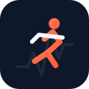

# Coach Sportif

<p align="center">
  
</p>

<p align="center">
  <strong>Coach autonome d'entraînement en course à pied, trail et récupération.</strong><br>
  Planification dynamique, adaptation physiologique (sommeil, VFC, charge), intégrations multi-plateformes et briefings quotidiens.
</p>

<p align="center">
  <a href="LICENSE"></a>
  
  
</p>

---

## 🏃 Points forts

- **100 % Local & Privé** : Vos données physiologiques, adresses et historiques restent sur votre machine (`COACH_HOME`). Aucune télémétrie.
- **Multi-plateformes & Multi-marques** : Fonctionne sous Linux, macOS et Windows. Compatible Garmin, Strava, Intervals.icu (Coros, Suunto, Polar) ou en mode autonome téléphone seul.
- **Adaptation intelligente** : Ajuste les allures et les volumes selon la fatigue réelle, la météo locale et les imprévus d'agenda.
- **Intégrations modulaires (no-op)** : Chaque service (ntfy, CalDAV, Home Assistant, Strava) s'active uniquement s'il est configuré.

---

## 🚀 Démarrage rapide (5 minutes)

### 1. Cloner et démarrer

```bash
git clone https://github.com/0-M-T/coach-sport.git
cd coach-sport

# Linux / macOS
./start.sh

# Windows (PowerShell)
.\start.ps1
```

### 2. Onboarding initial

- **Avec un agent IA** (Claude Code, Gemini CLI, Antigravity) : ouvrez le dossier et dites `« configure mon profil »`. L'agent déroulera l'entretien guidé (`prompts/onboarding.md`).
- **En ligne de commande** :
  ```bash
  cp templates/profile.example.yaml profile.yaml
  # Modifiez vos objectifs et physiologie dans profile.yaml
  ```

### 3. Consulter la séance du jour

```bash
coach next
```

### 4. Vérifier les connexions

```bash
coach doctor
```

---

## 🏗️ Architecture

```
┌────────────────────────────────────────────────────────┐
│ MOTEUR COACH-SPORT (Code public et déterministe)       │
│ - Décision du jour, charge et progression              │
│ - Connecteurs : Garmin, Strava, Intervals, CalDAV      │
└──────────────────────────┬─────────────────────────────┘
                           │
             Lecture runtime locale :
                           ▼
┌────────────────────────────────────────────────────────┐
│ VOTRE PROFIL ATHLÈTE (Local / COACH_HOME)              │
│ - profile.yaml (VMA, FC max, seuils, matériel)         │
│ - plan.yaml (objectifs, blocs, créneaux)               │
│ - coach.env (clés API optionnelles, chmod 600)         │
└────────────────────────────────────────────────────────┘
```

---

## 📱 Niveaux d'utilisation

| Niveau | Équipement | Sorties |
| :--- | :--- | :--- |
| **Essentiel** | Ordinateur seul | Séances détaillées en console, export calendrier `.ics`. |
| **Mobile** | + Téléphone avec appli ntfy (gratuite) | Briefing matinal au réveil et rappel du soir avec météo. |
| **Connecté** | + Montre (Garmin, Coros, Suunto) | Séances envoyées sur la montre, débriefs automatiques Strava. |

---

## 🏥 Avertissement Médical

Ce logiciel est un outil d'aide à la planification personnelle et ne remplace en aucun cas un avis médical ou le suivi d'un professionnel de santé (médecin du sport, kinésithérapeute). Voir [`DISCLAIMER.md`](DISCLAIMER.md) et [`docs/SECURITE.md`](docs/SECURITE.md).

---

## 📄 Licence

Distribué sous licence **MIT**. Voir [`LICENSE`](LICENSE) pour plus d'informations.
